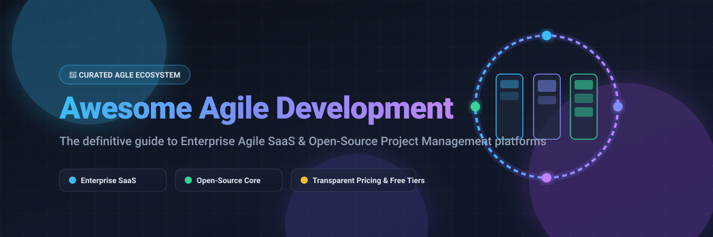

# 🚀 Awesome Agile Development

  <strong>A curated list of top Agile development platforms, Scrum & Kanban software, enterprise project management tools, and modern self-hosted open-source alternatives.</strong>

  <a href="#-sector-overview--market-dynamics">Sector Overview</a> •
  <a href="#-enterprise--commercial-saas-platforms">SaaS Platforms</a> •
  <a href="#-open-source-agile--scrum-platforms">Open-Source Platforms</a> •
  <a href="#-key-methodologies-covered">Methodologies</a> •
  <a href="#-support">Support</a> •
  <a href="#-star-history">Star History</a> •
  <a href="#-contributing">Contributing</a>

---

## 🌐 Sector Overview & Market Dynamics

The global agile project management software market is valued at approximately **$5.4 billion in 2024 and projected to reach $11.8 billion by 2030 (CAGR ~13.8%)**. The sector exhibits **moderate fragmentation with high enterprise concentration**, where legacy giants like Microsoft and Atlassian dominate enterprise ecosystems through bundled toolchains, while specialized innovators (ClickUp, Linear, monday.com) and extensible open-source platforms contest developer and modern product workflows.

---

## 💼 Enterprise & Commercial SaaS Platforms

Commercial and proprietary Agile project management suites, sorted descending by company scale (Valuation / Market Capitalization / Annual Revenue).

| Product | Company Scale (Valuation / Revenue) | Pricing (Starting Tier) | Free Tier Limits | Primary Focus / Notes |
|:---|:---|:---|:---|:---|
| 🔷 **[Microsoft Azure DevOps](https://azure.microsoft.com/services/devops/)** | **~$3.1 Trillion** market cap (Microsoft) | **$6/user/month** (Basic Plan; first 5 users free) | **Free forever up to 5 users** (Includes Azure Boards, Repos, 1 free Microsoft-hosted CI/CD pipeline with 1,800 min/month, unlimited private Git repos) | Enterprise backlog tracking, Scrum/Kanban boards, CI/CD pipelines, integrated testing |
| 🏷️ **[Broadcom Rally](https://www.broadcom.com/products/software/value-stream-management/rally)** | **~$800 Billion** market cap (Broadcom) | **$20/user/month** (Enterprise list pricing starting rate) | **14-day free trial** (Full enterprise portfolio & SAFe features; no perpetual free tier) | Scaled Agile Framework (SAFe), enterprise value stream management, large portfolio governance |
| 🔷 **[Apptio Targetprocess](https://www.apptio.com/products/targetprocess/)** | **$4.6 Billion** acquisition valuation by IBM (~$200B market cap) | **$25/user/month** (Starting professional edition) | **30-day free trial** (Full SAFe / portfolio capability; no perpetual free tier) | Enterprise Agile Planning (EAP), visual portfolio mapping, OKR tracking, multi-team alignment |
| 🔷 **[Atlassian Jira Software](https://www.atlassian.com/software/jira)** | **~$45 Billion** market cap (Atlassian) | **$7.75/user/month** (Standard Tier) | **Free forever up to 10 users** (Includes 2 GB file storage, Scrum/Kanban boards, standard roadmaps, community support) | Industry-standard issue tracking, sprint planning, agile velocity charts, deep ecosystem apps |
| 📅 **[monday.com](https://monday.com/work-management)** | **~$14 Billion** market cap | **$9/user/month** (Basic Tier, billed annually; min 3 seats = $27/mo) | **Free forever up to 2 users** (Up to 3 boards, 200+ templates, unlimited docs, 500 MB storage) | Visual work operating system, customizable sprint boards, timeline Gantt charts, automation |
| ⚡ **[Asana](https://asana.com)** | **~$3.2 Billion** market cap | **$10.99/user/month** (Starter Tier, billed annually) | **Free forever up to 10 users** (Unlimited tasks, projects, messages, activity log, 100MB per file storage, list/board/calendar views) | Cross-functional project management, sprint iterations, workload tracking, portfolio views |
| 🎯 **[ClickUp](https://clickup.com)** | **~$4.0 Billion** valuation | **$7/user/month** (Unlimited Tier, billed annually) | **Free forever unlimited users** (Includes 100 MB cloud storage, 60 uses of custom fields, collaborative docs, real-time chat, sprint points) | All-in-one productivity suite, flexible task hierarchy, Whiteboards, native sprint points |
| 🚀 **[Linear](https://linear.app)** | **~$400 Million** valuation | **$8/user/month** (Standard Tier, billed annually) | **Free forever up to 250 active issues** (Unlimited members, full cycles & project management, 10 MB file uploads) | High-speed, keyboard-centric issue tracking built specifically for high-growth software teams |
| 🐱 **[Shortcut](https://shortcut.com)** | **~$100 Million+** valuation | **$8.50/user/month** (Team Tier, billed annually) | **Free forever up to 10 users** (Full access to Stories, Sprints/Iterations, Epics, docs, unlimited teams) | Agile project management engineered for software teams, integrating sprints with roadmap roadmapping |

---

## 🔓 Open-Source Agile & Scrum Platforms

Self-hosted, transparent, and community-driven Agile and Kanban tools, sorted descending by GitHub stargazers.

| Project | Stars | Tech Stack | License | Description |
|:---|:---:|:---|:---|:---|
| 🚀 **[Plane](https://plane.so)** |  | TypeScript, Python, Django | AGPL-3.0 | Modern open-source project management platform alternative to Jira and Linear with cycles, modules, issue boards, and analytics. |
| 📋 **[Focalboard](https://www.focalboard.com)** |  | Go, TypeScript, React | AGPL-3.0 | Self-hosted multilingual project management and Kanban board alternative to Trello, Notion, and Asana created by Mattermost. |
| 💬 **[Zulip](https://zulip.com)** |  | Python, Django, TypeScript | Apache-2.0 | Powerful open-source organized team chat with unique threaded conversations designed for agile engineering workflows. |
| 📌 **[Wekan](https://wekan.github.io)** |  | Node.js, Meteor, MongoDB | MIT | Distributed open-source Kanban board with collaborative card lists, swimlanes, WIP limits, and Gantt charts. |
| 🏢 **[OpenProject](https://www.openproject.org)** |  | Ruby on Rails, Angular | GPL-3.0 | Leading open-source agile project management platform offering classic, Agile, and hybrid project management with roadmaps and sprint boards. |
| 🗂️ **[Planka](https://planka.app)** |  | React, Redux, Node.js, PostgreSQL | AGPL-3.0 | Elegant and lightweight real-time Kanban tracking board for agile teams, tracking cards, lists, attachments, and user activities. |
| 🏛️ **[Phabricator](https://www.phacility.com)** |  | PHP | Apache-2.0 | Complete suite of open-source software development collaboration tools including Maniphest task tracking, differential code review, and sprint boards. |
| 💡 **[Leantime](https://leantime.io)** |  | PHP, JavaScript | AGPL-3.0 | Open-source strategic project management system for innovators combining Lean, Agile, and design thinking methodologies. |
| 🪟 **[Kanboard](https://kanboard.org)** |  | PHP, SQLite/MySQL | MIT | Minimalist, self-hosted visual Kanban board focused on simplicity, WIP (Work In Progress) constraints, and automated actions. |
| 📝 **[Vikunja](https://vikunja.io)** |  | Go, TypeScript, Vue | AGPL-3.0 | Fast, modern open-source to-do and project management application featuring Kanban boards, Gantt charts, subtasks, and reminders. |
| 🥋 **[Taiga](https://taiga.io)** |  | Python, Django, AngularJS | AGPL-3.0 | Award-winning open-source project management platform built for cross-functional agile teams supporting Scrum, Kanban, and epics. |

---

## 🎯 Key Methodologies Covered

- 🏃 **Scrum**: Sprint planning, backlog refinement, velocity measurement, burndown charts, and retrospective reviews.
- 📊 **Kanban**: Continuous flow, explicit WIP (Work In Progress) limits, cycle time tracking, and swimlanes.
- 📐 **Scaled Agile Framework (SAFe)**: Program Increment (PI) planning, multi-tiered roadmaps, and enterprise architecture governance.
- ⚡ **Scrumban & Extreme Programming (XP)**: Flexible iterative cadences, rapid bug triage, continuous deployment tracking, and pair programming boards.

---

## 🤝 Contributing

Contributions are warmly welcomed! Please check out the guidelines below:

1. 🍴 Fork this repository.
2. 🌿 Create your feature branch (`git checkout -b feature/agile-tool`).
3. ✍️ Ensure SaaS entries contain verified pricing, free tier specs, and company valuation data.
4. ⭐ Ensure Open-Source entries include a valid GitHub star badge link and repository metadata.
5. 🚀 Commit your changes (`git commit -m 'feat: add agile tool'`).
6. 📬 Open a Pull Request!

---

## 💖 Support

Thank you for exploring and using **Awesome Agile Development**! If you find this curated resource helpful:
- ⭐ **Star** this repository to help others discover it!
- 🍴 **Fork** and share it with your agile team, colleagues, and community!
- 📢 **Spread the word** across social media, developer communities, and agile networks!
- ☕ **Buy me a coffee / Sponsor**: Support continued curation and open-source maintenance via the [GitHub Sponsor Dashboard](https://github.com/sponsors/ishandutta2007).

---

## 📈 Star History

---

## 📄 License

Distributed under the MIT License. See [LICENSE](LICENSE) for more information.
